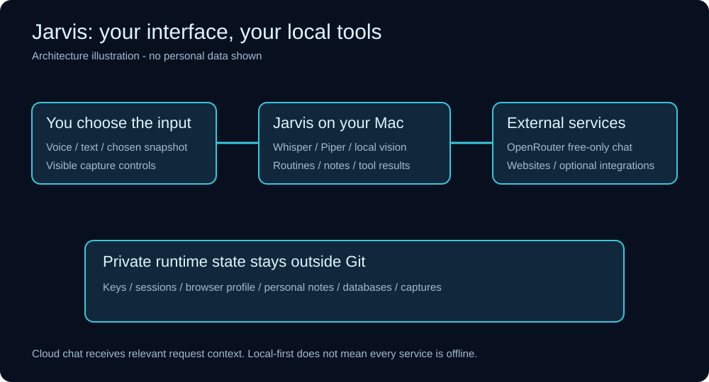
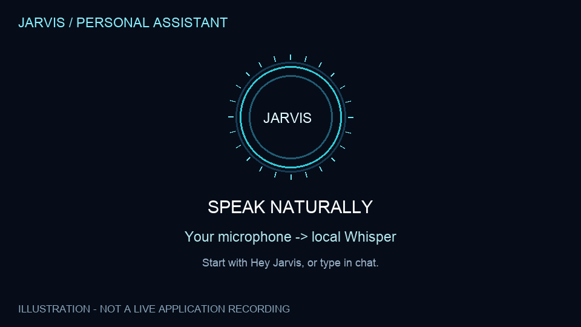

# Jarvis — Personal Assistant

A customized, local-first assistant built on [OpenJarvis](https://github.com/open-jarvis/OpenJarvis). Talk to Jarvis, open your saved workspaces, create reusable routines, inspect a chosen screen snapshot, and explore linked Markdown notes.



> This is a sanitized snapshot of an installed personal project, not a polished one-click product. The backend source and built web interface are included. The original React/TypeScript source, original Swift app source, and native Rust extension sources could not be recovered from the readable installation. See [provenance](PROVENANCE.json).

## What is here

| Capability | Implementation | Practical limit |
|---|---|---|
| Voice conversations | Local Whisper transcription and Piper speech; Kokoro adapter retained | Microphone permission, local models, and playback permission are required |
| Circular assistant and optional gestures | Existing built chat interface | Original editable frontend source is unavailable |
| Reusable routines | Save a phrase, HTTPS websites, and optional reminders | Reopens pages; does not read authenticated inboxes or submit forms |
| Resume my work | Explicitly save document paths, websites, and a next step | Restores only what you chose; no automatic desktop surveillance |
| Teach a shortcut | Record page navigation in Jarvis's dedicated browser; review before saving | Navigation only; query strings/fragments stripped; up to 8 pages |
| Screen explanation | Select a screen/window, capture one frame, summarize with local Ollama vision, optionally read aloud | Browser screen-share support varies; screenshot upload is a fallback |
| Knowledge galaxy | Build a 3D graph from Markdown with a standard-library Python indexer/server | Example notes only; no owner's notes are included |
| Research and reports | Web research modules and PDF/Word export source | Provider/model availability affects results; needs fresh-install verification |
| Reminders | Local inbox and deterministic scheduler source | Mac must remain awake; no personal schedules are shipped |
| Slack and phone alerts | Optional bridge and generic outbound notification source | Requires your own connection setup; disabled/unpaired by default |
| REA website inspection | Optional website-only observation adapter | Requires separately installed pinned tooling; no login or site changes |

The default chat route is **OpenRouter free-only**. Free service limits and delays still apply. No paid fallback is configured. This does not mean every optional provider shipped by upstream OpenJarvis is free: do not add paid keys or enable paid integrations unless you intend to use them.

## Quick start

This export targets **macOS**, primarily Apple Silicon. Start with [SETUP.md](docs/SETUP.md). Existing Jarvis users should not run the installer over their current installation; it deliberately refuses to overwrite `~/.openjarvis/runtime`.

```sh
python3 scripts/setup.py
# Follow the printed installation instructions, then:
python3 scripts/start.py
```

After setup, open `http://127.0.0.1:18766`. This is a local web app; a native signed app installer is not included.

For the standalone knowledge galaxy:

```sh
python3 galaxy/build.py galaxy/example-notes
python3 galaxy/server.py
# Open http://127.0.0.1:4700
```

Check `python3 galaxy/build.py --help` if your Python version uses a different notes argument format.

## Useful commands

- **AI roundup** — opens a routine you configure with your preferred research sources.
- **Pick up where I left off** — reopens the explicit saved handoff.
- **Look at my screen and explain what it is** — opens a selection panel in the main chat. You still choose the capture surface.
- **Remind me in ten minutes to take a break** — saves a local reminder.

Routines are edited at `/personal/routines`. A shortcut opens only the pages it records. It does not replay arbitrary clicks, purchases, logins, or typed passwords.

## Illustrated walkthrough



This animation uses fictional demonstration content. It is **not footage of the running application** and is not evidence of performance. See [MEDIA.md](docs/MEDIA.md) for a real recording checklist. No private screenshots, recordings, credentials, or personal notes are included.

## Repository map

- `vendor/OpenJarvis/` — recovered upstream Python source with local changes.
- `runtime/` — custom modules, routine editor, and distributable web assets.
- `galaxy/` — standard-library notes indexer, viewer, and sample notes.
- `config/` — example settings only.
- `scripts/` — setup, launch, key entry, and privacy scanning.
- `docs/` — architecture, limitations, setup, privacy, and demo guidance.

## Privacy before sharing

```sh
python3 scripts/privacy_scan.py
python3 scripts/privacy_scan.py --tracked
```

The scan fails on recognized token patterns, private key material, personal account links, private state files, or this installation's private home path. It prints file locations and finding categories, never matching secret strings. It is a useful safeguard, not a guarantee against every possible secret. Keep credentials in `~/.openjarvis`, never in this repository. See [PRIVACY.md](docs/PRIVACY.md).

Enable the local pre-commit check with:

```sh
git config core.hooksPath .githooks
```

## Status and attribution

The original assistant was used interactively; this export has not been end-to-end installed or benchmarked on a clean Mac. Source/package checks are described in [EXPORT-REPORT.md](docs/EXPORT-REPORT.md). This export does not call a model, run personal routines, post Slack messages, or play audio during verification.

Built on OpenJarvis, Apache-2.0. Included third-party assets keep their original notices where available; dependencies and voice models have their own licenses. See [THIRD-PARTY.md](docs/THIRD-PARTY.md). This project is not affiliated with OpenAI, Google, LinkedIn, NVIDIA, or Marvel.
